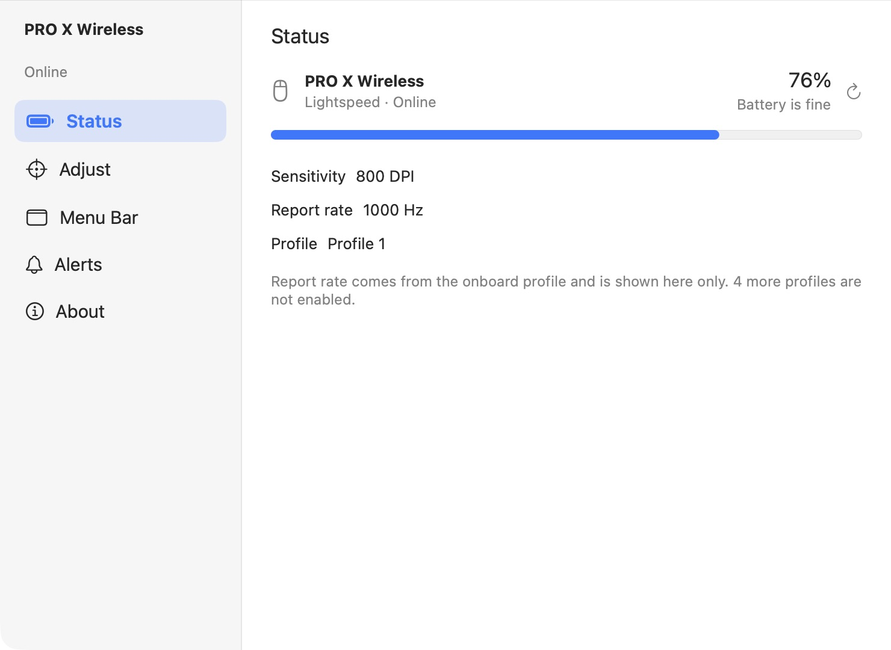
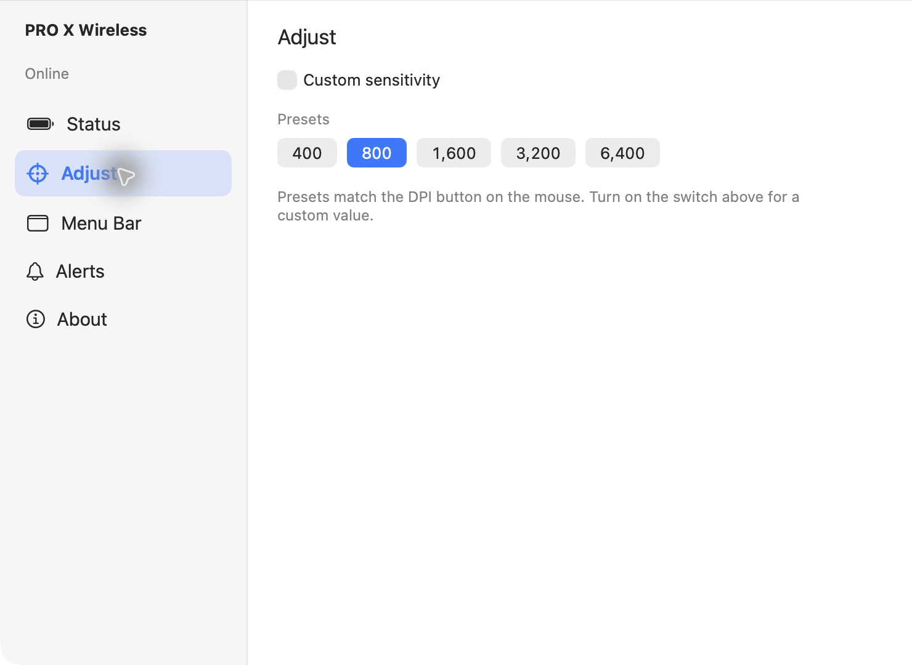
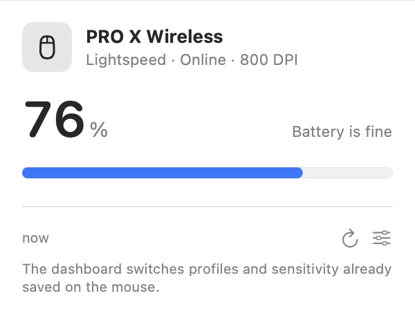
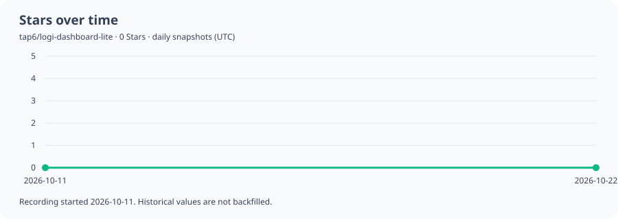

<p align="center">
  
</p>

<h1 align="center">Logi Dashboard Lite</h1>

<p align="center">Check your Logitech mouse battery from the macOS menu bar and adjust sensitivity on supported devices.</p>

<p align="center"><a href="README.md">简体中文</a> · <strong>English</strong></p>

<p align="center">
  <a href="https://github.com/tap6/logi-dashboard-lite/releases/latest"></a>
  
  
  <a href="https://github.com/tap6/logi-dashboard-lite/actions/workflows/build.yml"></a>
  <a href="LICENSE"></a>
  <a href="https://github.com/tap6/logi-dashboard-lite/stargazers"></a>
  <a href="https://github.com/tap6/logi-dashboard-lite/releases"></a>
</p>

**[Download the latest release](https://github.com/tap6/logi-dashboard-lite/releases/latest)** · **[Check compatibility](#will-my-mouse-work)** · **[Report a device](https://github.com/tap6/logi-dashboard-lite/issues/new)**

An unofficial SwiftUI utility, not affiliated with Logitech. It reads device status through HID++ and focuses on battery monitoring and existing onboard DPI settings.

## Features

- Battery level, connection, sleep, offline and charging states in the menu bar, with an optional persistent percentage.
- A dashboard showing current DPI, onboard profiles and the report rate stored in the active profile.
- On devices exposing the required HID++ features: switch saved onboard profiles and DPI presets, or adjust the current sensor DPI.
- Configurable low-battery notifications and optional launch at login.
- Simplified Chinese, Traditional Chinese and English interfaces, following the app/system language.

Report rate is displayed only. Button remapping, macro editing, receiver pairing and firmware updates are not provided. The app does not rewrite the stored DPI preset list and is not a complete replacement for Logi Options+ or G HUB.

## Screenshots

The connected device is **PRO X Wireless / Lightspeed**, reporting **76% battery**, **800 DPI** and a **1000 Hz onboard report rate**. These are captures of the app's original SwiftUI views in a separate documentation window using a real, read-only hardware snapshot. No desktop, username, file path or unique device ID is included. Readings change over time.



<details>
<summary>View sensitivity controls</summary>



</details>



[See Chinese screenshots in the default README](README.md#界面截图).

## Will my mouse work?

**The device confirmed with real hardware is `PRO X Wireless`, the model name returned by HID++, connected through Lightspeed.** Battery, connection state, current DPI, onboard profile and report-rate reads have been verified. This does not establish compatibility for the entire PRO X / Superlight family. DPI writes and profile switching have not been verified on every model below.

Device detection is based on HID++ capabilities, not a model allowlist. These familiar model names help you locate your device; **they are not a fully tested support list**.

| Family / common models | Verification | Battery and connection | DPI and profile controls |
| --- | --- | --- | --- |
| **PRO X Wireless**, Lightspeed connection | **Hardware reads verified** | Read successfully on the current device | Current DPI/profile read; changes depend on exposed features |
| PRO X Superlight, PRO X Superlight 2, G305, G502 X Lightspeed, G603, G604, G703, G903 | Awaiting hardware tests | Try if accessible HID++ battery features are exposed | Requires onboard-profile `0x8100` / DPI `0x2201` features |
| MX Master, MX Master 2S, MX Master 3, MX Anywhere 2S, MX Anywhere 3, MX Ergo, MX Vertical, M720 | Awaiting hardware tests | Try through the appropriate receiver or Bluetooth if HID++ is accessible | Model name alone does not guarantee controls; status only when required features are absent |
| MX Master 3S, MX Anywhere 3S, Lift, Signature M650 | Awaiting hardware tests | Bolt / Bluetooth requires an accessible HID++ interface | Onboard profiles and DPI controls are not guaranteed |
| M185, M220, M310, M330, M525 | Awaiting hardware tests | Requires a compatible receiver and HID++; some devices only report battery levels | DPI / onboard profile controls are not guaranteed |

Hardware revisions, firmware, receiver and connection mode can affect results. Recognizing a receiver does not guarantee battery support for every paired device.

### Receivers and connection modes

The code explicitly recognizes the following receiver product IDs under Logitech USB vendor ID `046D`:

| Type | Product IDs (hex) | Notes |
| --- | --- | --- |
| Unifying | `C52B`, `C532` | Attempts to read paired devices |
| Lightspeed | `C537`, `C539`, `C53A`, `C53F`, `C545`, `C547` | Used by the currently tested device; not every PID has been tested |
| Logi Bolt | `C548` | Detection path implemented; more hardware tests needed |
| Nano | `C517`, `C52F`, `C534` | Attempts HID++ 1.0 / 2.0 reads |
| Bluetooth / direct USB | Does not depend on receiver PIDs above | Requires an exposed vendor-specific HID++ interface; not every direct device is readable |

Other receivers with `Receiver` in the product name may also be detected, but functionality still depends on the protocol. Only Logitech vendor-specific Usage Pages `0xFF00` / `0xFF43` are matched, not ordinary keyboard and pointer input interfaces.

Battery decoding includes HID++ 2.0 features `0x1004` / `0x1000` and HID++ 1.0 legacy battery registers. Check [MouseSupport.swift](Logi%20Dashboard%20Lite/Models/MouseSupport.swift) and [ReceiverCatalog.swift](Logi%20Dashboard%20Lite/Models/ReceiverCatalog.swift) for the current catalog.

To report compatibility, open an Issue with **model, connection mode, macOS version, and whether battery/DPI/profile features work separately**. Serial numbers, usernames and full system logs are not needed.

## Download and install

1. Download `Logi-Dashboard-Lite-1.0.2-macOS-universal.zip` from [Releases](https://github.com/tap6/logi-dashboard-lite/releases/latest).
2. Extract it and move `Logi Dashboard Lite.app` to Applications.
3. Launch it and click the mouse icon in the top menu bar. The main window does not open automatically. Left-click to toggle the mouse panel; right-click (or Control-click) opens only the menu. Open the dashboard from the panel, or use the menu for settings.

**Requires macOS 14.0 or later.** The archive contains both `arm64` and `x86_64`; it targets Sonoma 14, Sequoia 15, Tahoe 26 and later. Deployment-target compilation and binary checks passed for macOS 14, but runtime testing on macOS 14 hardware is still pending. Screenshots were captured on a newer system, so appearance may differ.

[Minimum OS rationale and verification scope](docs/COMPATIBILITY.md).

This release is **ad-hoc signed, without Developer ID signing or Apple notarization**. macOS may block its first launch after downloading. If you choose to run it, verify the download source and `SHA256SUMS.txt`, then follow [Apple's official instructions](https://support.apple.com/102445) to use Open Anyway for this app in System Settings → Privacy & Security.

Low-battery alerts require notification authorization, and launch at login may need system approval. The app accesses vendor HID++ channels and does not enable App Sandbox.

### Troubleshooting

- **No mouse found:** verify the receiver/connection, wake the mouse and refresh. Bluetooth also requires an accessible HID++ channel.
- **Receiver cannot be read:** another app such as Logi Options+ or G HUB may have it open; quit that app and retry.
- **Battery works but DPI does not:** required onboard-profile/sensor features are absent, or another app has put the device in host-managed mode.
- **Only a battery level is shown:** some devices do not expose an exact percentage.
- **Check for Updates:** opens GitHub Releases in your browser. There are no background update requests or automatic installations.

## Privacy

No account, analytics SDK or background network requests. Hardware access and preferences stay local. Notification deduplication stores local identifiers derived from connection location and pairing slot; hardware serial numbers are not read. Local system logs contain scan counts and some control state. Debug builds additionally log model, battery and DPI. Clicking Check for Updates opens GitHub in your default browser.

Public source excludes personal Xcode settings, development-team identifiers, certificates, caches and local design explorations. The [publication check](scripts/check-publication.py) scans common credentials, private paths and contact emails; pattern scans cannot guarantee detection of every sensitive value. README badges are served by Shields.io / GitHub and are separate from the app's data handling.

See the [publication privacy review](docs/PRIVACY_CHECK.md). The release script also remaps compiler-embedded local source paths and scans the entire app bundle.

## Build from source

Requires **Xcode 26.4 or later** and the corresponding macOS SDK. This release was compiled with Xcode 27.0. No third-party dependencies.

```bash
git clone https://github.com/tap6/logi-dashboard-lite.git
cd logi-dashboard-lite
bash scripts/test.sh
bash scripts/build-release.sh
```

The universal ZIP and checksums are written to `dist/`. Alternatively, open `Logi Dashboard Lite.xcodeproj` and choose your own signing team for local development. The build script uses ad-hoc signing; it does not notarize or upload anything.

`scripts/test.sh` runs the existing HID++ decoding assertions for packets, battery, device types, onboard profiles and DPI. GitHub Actions runs these checks and builds the universal app. Passing tests does not imply compatibility with every device.

See [screenshot reproduction notes](docs/screenshots/README.md).

## Stars over time



Daily total Stars snapshots (UTC) are recorded from **2026-10-11**, without fabricated or backfilled history. A new repository starts with one observation; scheduled GitHub Actions updates create the time series. These are total-count observations, not precise timestamps for every star event. No stargazers' identities are collected.

[View the table](docs/stars-history.md) · [Raw CSV](docs/stars-history.csv) · [Update runs](https://github.com/tap6/logi-dashboard-lite/actions/workflows/stars.yml)

## License and attribution

Source code is licensed under [GNU GPL v3.0](LICENSE) (`GPL-3.0-only`). Logitech, Logi, Lightspeed, Unifying, Bolt and related product names belong to their respective owners. This is an unofficial project; compatibility with untested devices is not guaranteed.
