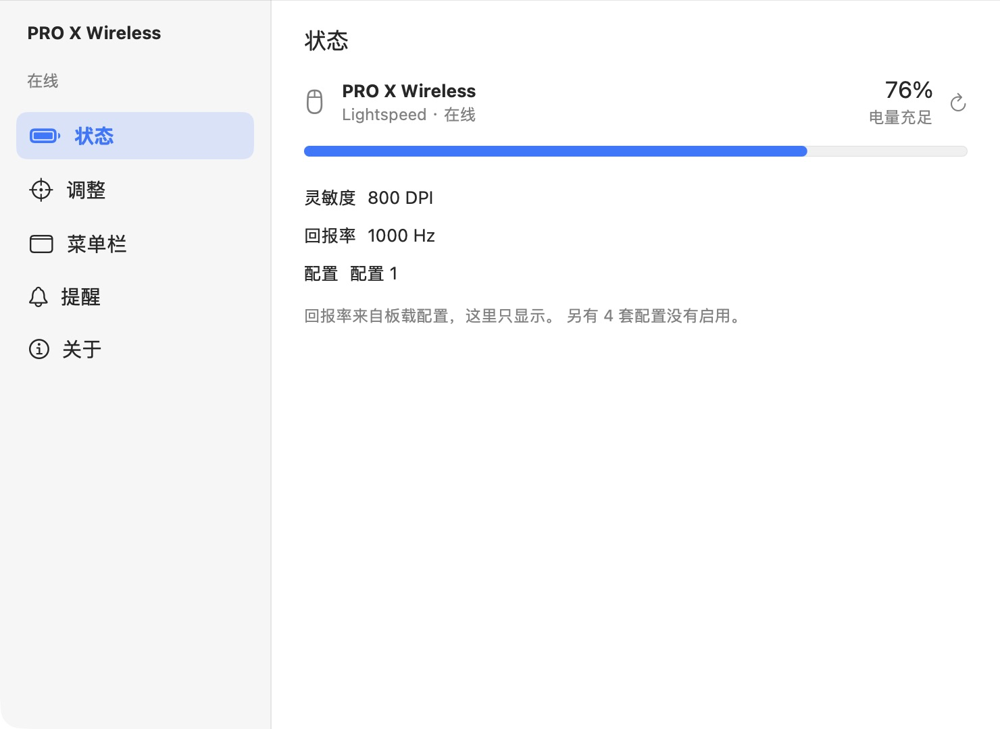
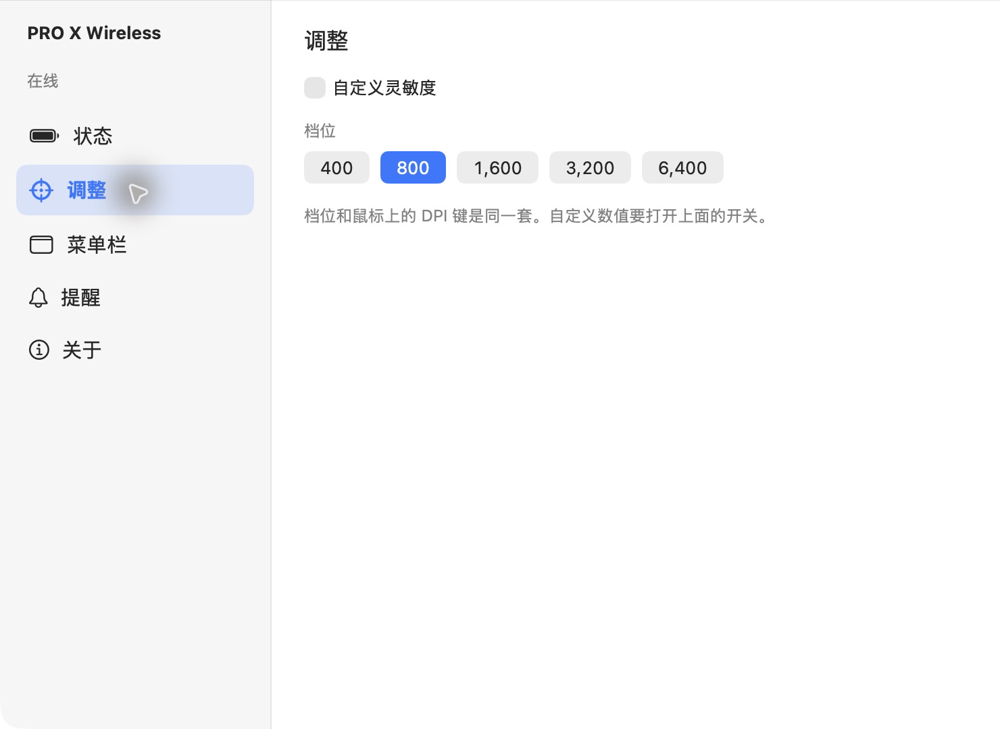
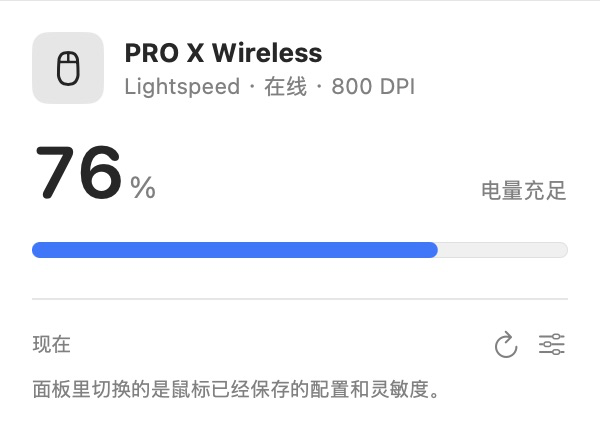

<p align="center">
  
</p>

<h1 align="center">Logi Dashboard Lite</h1>

<p align="center">在 macOS 菜单栏查看罗技鼠标电量，轻松调整受支持设备的灵敏度。</p>

<p align="center"><strong>简体中文</strong> · <a href="README.en.md">English</a></p>

<p align="center">
  <a href="https://github.com/tap6/logi-dashboard-lite/releases/latest"></a>
  
  
  <a href="https://github.com/tap6/logi-dashboard-lite/actions/workflows/build.yml"></a>
  <a href="LICENSE"></a>
  <a href="https://github.com/tap6/logi-dashboard-lite/stargazers"></a>
  <a href="https://github.com/tap6/logi-dashboard-lite/releases"></a>
</p>

**[下载最新版](https://github.com/tap6/logi-dashboard-lite/releases/latest)** · **[查看鼠标兼容性](#我的鼠标能用吗)** · **[反馈兼容情况](https://github.com/tap6/logi-dashboard-lite/issues/new)**

这是一个非官方的 SwiftUI 小工具，与 Logitech 无隶属关系。它通过 HID++ 读取设备状态，适合只想查看电量、调整已有板载 DPI 配置的用户。

## 能做什么

- 菜单栏查看电量，以及在线、休眠、离线和充电状态；可选择一直显示电量百分比。
- 仪表盘查看当前 DPI、板载配置及配置中的回报率。
- 在具备对应 HID++ 功能的鼠标上，切换已保存的板载配置、DPI 预设，或调整当前传感器 DPI。
- 设置低电量提醒阈值，选择是否开机启动。
- 界面支持简体中文、繁体中文和英文，跟随应用/系统语言。

回报率只显示，不支持修改。应用不提供按键重映射、宏编辑、接收器配对或固件升级，也不改写板载预设列表。它不等同于 Logi Options+ 或 G HUB 的完整替代品。

## 界面截图

截图使用当前连接的 **PRO X Wireless / Lightspeed**：电量 **76%**、灵敏度 **800 DPI**、板载回报率 **1000 Hz**。图片来自软件原有 SwiftUI 界面的独立文档窗口，使用实机只读快照；没有桌面、用户名、路径或设备唯一标识。数值随设备状态变化。



<details>
<summary>查看灵敏度调整界面</summary>



</details>



[英文界面截图在 English README 中查看](README.en.md#screenshots)。

## 我的鼠标能用吗？

**当前实机确认能读取的设备是 `PRO X Wireless`（设备通过 HID++ 返回的型号名），使用 Lightspeed 接收器。** 已确认电量、连接状态、当前 DPI、板载配置及回报率读取。尚不能据此认定整个 PRO X / Superlight 系列都兼容，也没有逐一验证下列型号的 DPI 写入和配置切换。

应用按 HID++ 协议功能识别设备，不按型号白名单识别。下面是帮助你检索的常见型号参考，**不是全部实测通过的清单**：

| 鼠标系列 / 常见型号 | 验证状态 | 电量与连接 | DPI 与配置调整 |
| --- | --- | --- | --- |
| **PRO X Wireless**，Lightspeed 连接 | **实机读取已验证** | 当前设备已读取 | 已读取当前 DPI/配置；调整依赖设备功能 |
| PRO X Superlight、PRO X Superlight 2、G305、G502 X Lightspeed、G603、G604、G703、G903 | 待实测 | 若提供可访问的 HID++ 电量功能，可尝试 | 需设备暴露板载配置 `0x8100` / DPI `0x2201` 功能 |
| MX Master、MX Master 2S、MX Master 3、MX Anywhere 2S、MX Anywhere 3、MX Ergo、MX Vertical、M720 | 待实测 | 通过相应接收器或蓝牙暴露 HID++ 时可尝试 | 不能仅凭型号保证可调；没有所需功能时仅显示状态 |
| MX Master 3S、MX Anywhere 3S、Lift、Signature M650 | 待实测 | Bolt / 蓝牙路径需可访问 HID++ 接口 | 同上；不承诺板载配置或 DPI 调整 |
| M185、M220、M310、M330、M525 | 待实测 | 需兼容接收器和 HID++；部分设备可能只报告电量等级 | 不承诺 DPI / 板载配置调整 |

同名型号的不同版本、固件、接收器及连接方式可能影响结果。接收器被识别，也不代表所有配对设备都能读取电量。

### 接收器与连接方式

代码显式识别 Logitech USB 厂商 ID `046D` 下的这些接收器产品 ID：

| 类型 | 产品 ID（十六进制） | 说明 |
| --- | --- | --- |
| Unifying / 优联 | `C52B`、`C532` | 尝试读取接收器上的已配对设备 |
| Lightspeed | `C537`、`C539`、`C53A`、`C53F`、`C545`、`C547` | 当前实测设备使用此类连接；各 PID 未全部实测 |
| Logi Bolt | `C548` | 已有识别路径，待更多实机验证 |
| Nano | `C517`、`C52F`、`C534` | 尝试使用 HID++ 1.0 / 2.0 读取 |
| 蓝牙 / USB 直连 | 不依赖上述接收器 PID | 设备需暴露厂商自定义 HID++ 接口；并非所有直连设备可读 |

程序还会根据产品名称识别其他含 `Receiver` 的接收器，但能否工作仍取决于协议。仅读取 Logitech 厂商自定义 Usage Page `0xFF00` / `0xFF43`，不匹配系统键盘和鼠标的普通输入接口。

协议解析包含 HID++ 2.0 电量功能 `0x1004` / `0x1000`，以及 HID++ 1.0 旧电量寄存器。型号和接收器表可在 [MouseSupport.swift](Logi%20Dashboard%20Lite/Models/MouseSupport.swift) 与 [ReceiverCatalog.swift](Logi%20Dashboard%20Lite/Models/ReceiverCatalog.swift) 中核对。

如果你的型号尚未确认，欢迎提交 Issue，写明**型号、连接方式、macOS 版本，以及电量/DPI/配置分别是否可用**。无需提供序列号、用户名或完整系统日志。

## 下载与安装

1. 从 [Releases](https://github.com/tap6/logi-dashboard-lite/releases/latest) 下载 `Logi-Dashboard-Lite-1.0.2-macOS-universal.zip`。
2. 解压，将 `Logi Dashboard Lite.app` 放入“应用程序”文件夹。
3. 启动后点击顶部菜单栏的鼠标图标；应用默认不弹出主窗口。左键打开或关闭鼠标面板，右键只显示菜单（Control＋左键也可）。在面板中打开仪表盘，或从右键菜单进入设置。

**系统要求：macOS 14.0 或更高版本。** 安装包包含 `arm64` 和 `x86_64`，支持 Sonoma 14、Sequoia 15、Tahoe 26 及更新系统。macOS 14 的最低版本编译与二进制检查已通过，但尚未在 macOS 14 实机验证；截图采集于较新系统，外观可能不同。

[最低版本选择与验证范围](docs/COMPATIBILITY.md)。

当前 Release 使用 **ad-hoc 临时签名，未做 Developer ID 签名或 Apple 公证**。从互联网下载后，macOS 可能阻止首次打开。如果你决定运行，请先核对下载来源和 `SHA256SUMS.txt`，再按 [Apple 的官方说明](https://support.apple.com/102445)，在“系统设置 → 隐私与安全性”中对这个应用选择“仍要打开”。

低电量提醒需要通知授权；开机启动可能需要在系统设置中批准。应用访问厂商 HID++ 通道，项目未启用 App Sandbox。

### 常见问题

- **没有找到鼠标**：确认连接方式和接收器，移动鼠标唤醒后点刷新；蓝牙模式也需要设备提供可访问的 HID++ 通道。
- **接收器无法读取**：Logi Options+ / G HUB 等软件可能占用设备，退出占用软件后重试。
- **有电量却不能改 DPI**：设备没有所需的板载配置 / 传感器功能，或处于其他软件控制的主机管理模式。
- **只显示电量等级**：某些设备不提供准确百分比，这不是读取失败。
- **检查更新**：菜单项会打开 GitHub Releases 页面；应用不在后台请求更新，也不会自动安装更新。

## 隐私

应用没有账号、统计 SDK 或后台网络请求，设备读取和设置保存在本机。通知去重会在本地偏好设置中保存由连接位置与配对槽生成的设备标识，不读取硬件序列号。系统本地日志包含扫描数量和部分控制状态；Debug 构建额外记录型号、电量及 DPI。点击“检查更新”时由默认浏览器打开 GitHub 页面。

公开源码已排除个人 Xcode 用户设置、开发团队标识、证书、缓存和本地设计草稿。[发布前检查脚本](scripts/check-publication.py) 会扫描常见密钥、私人路径和联系邮箱；模式扫描不能保证发现所有可能的敏感信息。README 的徽章由 Shields.io / GitHub 提供，与应用本身的数据处理无关。

[查看发布隐私检查记录](docs/PRIVACY_CHECK.md)。发布脚本还会把编译器嵌入的本机源码路径映射成通用路径，并扫描整个应用包。

## 从源码构建

需要 **Xcode 26.4 或更新版本**及相应 macOS SDK。本次发布在 Xcode 27.0 编译；项目无需第三方依赖。

```bash
git clone https://github.com/tap6/logi-dashboard-lite.git
cd logi-dashboard-lite
bash scripts/test.sh
bash scripts/build-release.sh
```

生成的通用 ZIP 和校验文件位于 `dist/`。也可以直接打开 `Logi Dashboard Lite.xcodeproj`；本地开发签名团队由你自行选择。构建脚本生成临时签名版本，不自动公证或上传。

`scripts/test.sh` 执行现有 HID++ 解码断言，覆盖报文、电量、设备类型、板载配置和 DPI 数据解析。GitHub Actions 会执行解析检查及通用构建；测试通过不等同于全部硬件兼容。

截图复现方法见 [截图说明](docs/screenshots/README.md)。

## Stars 时间图


图表从 **2026-10-11** 开始记录每日总 Stars 快照（UTC），不补造历史数据。新仓库初期只有一个观测点；每日 GitHub Actions 更新后会形成时间曲线。它记录每次采样的总数，不收集点赞用户身份，也不是每一次加星事件的精确时间。

[查看时间表](docs/stars-history.md) · [下载原始 CSV](docs/stars-history.csv) · [自动更新记录](https://github.com/tap6/logi-dashboard-lite/actions/workflows/stars.yml)

## 许可证与声明

源码采用 [GNU GPL v3.0](LICENSE)（`GPL-3.0-only`）。Logitech、Logi、Lightspeed、Unifying、Bolt 及相关产品名称属于各自权利人。本项目非官方，也不保证未实测设备的兼容性。
